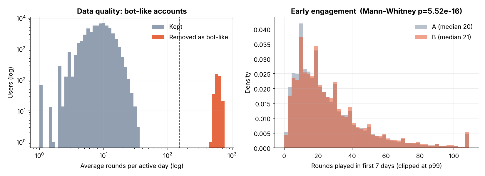
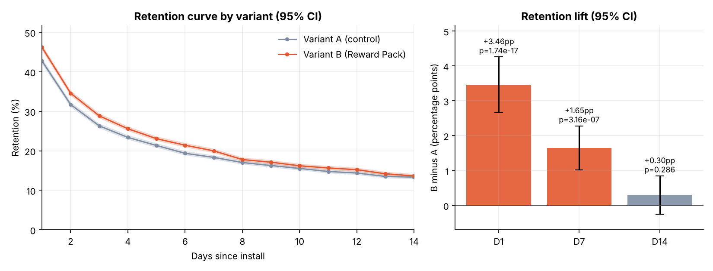
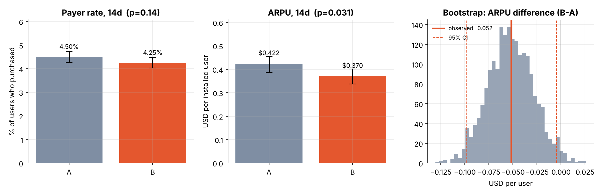
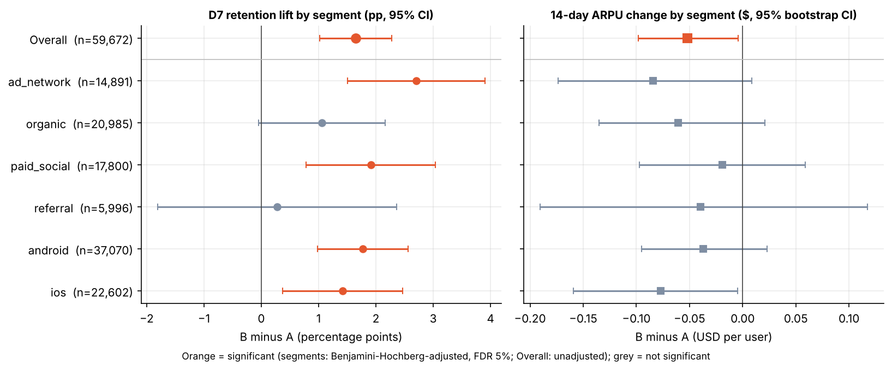
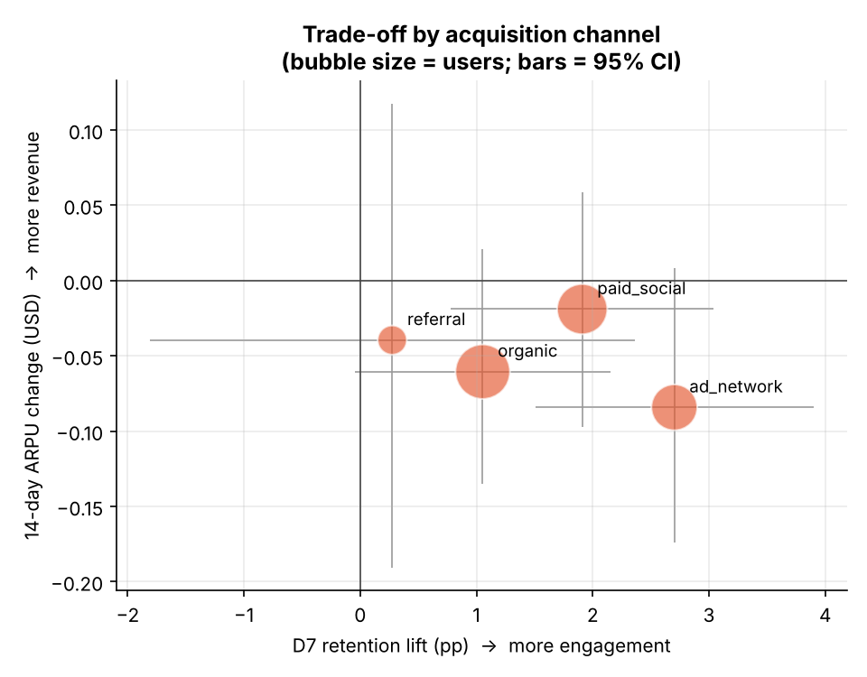

# 모바일 퍼즐게임 A/B 테스트 분석
### 웰컴 리워드팩은 리텐션을 올렸지만, 매출 비용을 치를 가치가 있는가?

> **데이터 안내 (중요)**
> 이 프로젝트의 데이터는 **합성 데이터(synthetic)** 입니다. `src/01_generate_data.py`에 데이터 생성 규칙이 그대로 공개되어 있고, 효과 크기는 생성 단계에서 심어 둔 값입니다. 따라서 이 프로젝트가 보여주는 것은 "게임 업계의 새로운 사실"이 아니라 **실험 분석의 전 과정(데이터 품질 → 실험 유효성 → 지표 → 세그먼트 → 의사결정)을 정확하게 수행하는 방법**입니다.

**Tools:** SQL(DuckDB) · Python(pandas, scipy, statsmodels, matplotlib)

---

## 1. 한눈에 보기 (TL;DR)

| 질문 | 결과 |
|---|---|
| 실험이 유효한가? | 유효. SRM 없음(p=0.41), 채널·플랫폼·국가 분포 균형 |
| 리텐션이 올랐나? | **D1 +3.46pp (p<0.001), D7 +1.65pp (p<0.001)**. D14는 +0.30pp로 유의하지 않음(p=0.29) |
| 매출 비용은? | **14일 ARPU −$0.052** (95% CI −$0.098 ~ −$0.005, p=0.031). 결제 전환율은 4.50% → 4.25% (유의하지 않음) |
| 모든 유저에게 효과가 같은가? | 아니요. **ad_network(+2.70pp)와 paid_social(+1.91pp)** 에서 효과가 가장 크고, organic·referral은 유의하지 않음 |
| 권고 | **광고 유입(ad_network, paid_social)에 우선 롤아웃**, organic·referral은 보류하고 후속 실험 설계 |

설치 1만 건당 환산하면 **D7 생존 유저 약 +165명, 14일 매출 약 −$520**입니다. 전체 기준으로 B가 본전이 되려면, 추가로 D7까지 남은 유저 1명이 이후 약 **$3.15 이상**의 매출을 만들어야 합니다.

---

## 2. 배경과 실험 설계

- **실험:** 신규 유저에게 첫 7일간 무료 부스터를 주는 "웰컴 리워드팩"
  - A = 대조군(리워드팩 없음), B = 처리군(리워드팩 지급), 설치 시점에 50:50 무작위 배정
- **가설:** 초반 보상이 첫 경험을 개선해 리텐션을 올린다. 단, 무료 부스터가 인앱 결제를 대체해 매출이 줄 수 있다.
- **지표 설계**

| 구분 | 지표 | 정의 |
|---|---|---|
| Primary | D7 리텐션 | 설치 7일째에 접속한 유저 비율 |
| Secondary | D1, D14 리텐션, 첫 7일 라운드 수 | |
| Guardrail | 결제 전환율, 14일 ARPU, ARPPU | 설치 후 14일 내 결제 기준 |

- **관측 기간:** 2026-09-01 ~ 09-28 설치 유저, 설치 후 14일 추적

## 3. 데이터

| 테이블 | 행 수 | 설명 |
|---|---|---|
| `users.csv` | 60,480 | user_id, install_date, variant, platform, channel, country |
| `sessions.csv` | 243,113 | 유저·일자별 세션 수, 라운드 수, 플레이 시간 |
| `purchases.csv` | 4,164 | 유저별 결제 내역(금액) |

## 4. 데이터 품질과 실험 유효성



| 이슈 | 규모 | 처리 |
|---|---|---|
| 완전 중복 유저 행 | 462행 (0.8%) | `DISTINCT`로 제거 |
| country 결측 | 956행 (1.6%) | 삭제하지 않고 `Unknown`으로 분류 |
| 봇 의심 계정 | 346명 (A 158 / B 188) | 일평균 라운드 150 초과 시 제외 |

- 봇 기준은 분포를 먼저 확인하고 정했습니다. 정상 유저의 일평균 라운드는 최대 33.6(99.9분위수 26)인 반면, 봇은 400 이상으로 완전히 분리됩니다(왼쪽 그림). 분석 대상은 **59,672명**입니다.
- **SRM(표본 비율 불일치) 검정:** A 29,736 / B 29,936, χ²=0.67, p=0.41 → 배정에 문제 없음
- **공변량 균형:** 채널 p=0.81, 플랫폼 p=0.13, 국가 p=0.11 → 무작위 배정이 잘 이뤄짐

## 5. 결과

### 5-1. 리텐션 (Primary)



| 지표 | A | B | 차이 | 95% CI | p |
|---|---|---|---|---|---|
| D1 | 42.75% | 46.21% | +3.46pp (+8.1%) | +2.67 ~ +4.26 | <0.001 |
| **D7** | 18.34% | 19.99% | **+1.65pp (+9.0%)** | +1.02 ~ +2.28 | <0.001 |
| D14 | 13.34% | 13.64% | +0.30pp | −0.25 ~ +0.85 | 0.29 |

**해석:** 효과는 리워드 기간(7일) 동안 뚜렷하고 이후 사라집니다. 리워드팩이 습관을 만든 것이 아니라 **보상이 있는 동안 접속을 늘린 것**에 가깝고, 이 패턴은 D14 효과가 0과 구분되지 않는다는 점과 일치합니다. 공변량(채널·플랫폼·국가)을 보정한 로지스틱 회귀에서도 D7 오즈비는 **1.11 (95% CI 1.07 ~ 1.16)** 로 결과가 같습니다.

### 5-2. 참여도

첫 7일 라운드 수는 평균 26.2 → 27.5, 중앙값 20 → 21로 소폭 증가했습니다(Mann-Whitney p<0.001). 표본이 커서 통계적으로는 유의하지만 **실질적 효과는 작습니다**. 리텐션 증가의 대부분은 "더 오래 하는 것"이 아니라 "다시 접속하는 것"에서 나옵니다.

### 5-3. 매출 (Guardrail)



| 지표 | A | B | 차이 | 95% CI | p |
|---|---|---|---|---|---|
| 결제 전환율 | 4.50% | 4.25% | −0.25pp | −0.58 ~ +0.08 | 0.14 |
| **ARPU (14일)** | $0.422 | $0.370 | **−$0.052** | −$0.098 ~ −$0.005 | 0.031 |
| ARPPU | $9.37 | $8.69 | −$0.68 | −$1.51 ~ +$0.10 | 0.09 |

**해석:** ARPU 하락은 경계선상에서 유의합니다. 결제 전환율과 ARPPU는 각각 유의하지 않지만 방향은 모두 음(−)이어서, 무료 부스터가 결제를 일부 대체한다는 가설과 방향이 일치합니다. ARPU는 결제가 드물고 금액이 치우친 지표이므로 부트스트랩(2,000회)으로 신뢰구간을 계산했습니다. 가드레일 지표를 여러 개 본 만큼 **p=0.031은 확정적 증거가 아니라 "비용이 있을 수 있다"는 신호**로 읽는 것이 맞습니다.

### 5-4. 세그먼트별 효과



| 세그먼트 | 유저 수 | D7 리프트 | 95% CI | BH 보정 p | ARPU 변화 | 손익분기 가치* |
|---|---|---|---|---|---|---|
| **ad_network** | 14,891 | **+2.70pp** | +1.50 ~ +3.90 | <0.001 | −$0.084 | $3.12 |
| **paid_social** | 17,800 | **+1.91pp** | +0.78 ~ +3.04 | 0.002 | −$0.019 | $0.99 |
| organic | 20,985 | +1.05pp | −0.05 ~ +2.16 | 0.073 | −$0.061 | $5.74 |
| referral | 5,996 | +0.28pp | −1.81 ~ +2.36 | 0.80 | −$0.040 | 해석 불가 |
| android | 37,070 | +1.77pp | +0.98 ~ +2.56 | <0.001 | −$0.037 | $2.09 |
| ios | 22,602 | +1.42pp | +0.37 ~ +2.47 | 0.012 | −$0.077 | $5.44 |

\* 손익분기 가치 = |ARPU 감소| ÷ D7 리프트. B가 본전이 되려면 **추가로 남은 유저 1명이 14일 이후 만들어야 하는 매출**입니다. referral은 D7 효과 자체가 0과 구분되지 않아 계산 의미가 없습니다.



- 세그먼트 6개를 동시에 검정하므로 **Benjamini–Hochberg(FDR 5%)** 로 p값을 보정했습니다. 보정 후에도 ad_network, paid_social, android, ios의 D7 효과는 유의합니다. ARPU 감소는 어느 세그먼트에서도 보정 후 유의하지 않습니다.
- 효과 이질성에 대한 전체 검정(채널×처리 상호작용, 우도비 검정)은 χ²=7.92, df=3, **p=0.048**로 **경계선상**입니다. "채널마다 효과가 다르다"는 증거는 있지만 강하지 않으므로, 아래 권고는 확정이 아니라 **우선순위 제안**으로 읽어야 합니다.
- 해석 가설: 광고 유입 유저는 의도가 낮아 초반 보상에 더 민감하게 반응하고, 이미 몰입한 organic·referral 유저는 보상이 없어도 남기 때문에 추가 효과가 작은 것으로 보입니다. 이는 데이터로 검증하지 않은 가설입니다.

### 5-5. 검정력

| 대상 | 최소 검출 가능 효과 (D7, 80% power) |
|---|---|
| 전체 | 0.89pp |
| ad_network / organic / paid_social | 약 1.6pp |
| referral | 2.98pp |

referral(약 6천 명)은 표본이 작아 **효과가 없는 것이 아니라 "있는지 모르는" 상태**입니다. organic의 D7 효과(+1.05pp)도 검출 한계(1.56pp)보다 작아 추정치가 불확실합니다.

## 6. 의사결정과 권고

1. **ad_network, paid_social에 우선 롤아웃.** D7 리프트가 보정 후에도 유의하고, 손익분기 가치($3.12, $0.99)가 상대적으로 낮습니다. 특히 paid_social은 ARPU 비용이 거의 없습니다(−$0.019).
2. **organic, referral은 보류.** 리프트가 유의하지 않은 상태에서 ARPU 비용만 부담할 수 있습니다.
3. **롤아웃 전 확인할 것:** 이 분석은 14일까지만 봅니다. "D7에 남은 유저의 이후 가치"가 손익분기 가치(채널별 위 표)를 넘는지는 **LTV 데이터로 확인해야** 하며, 이 프로젝트의 데이터로는 답할 수 없습니다.

## 7. 한계와 다음 단계

- **효과 지속성:** D14에서 효과가 사라졌습니다. D30 리텐션과 장기 매출까지 포함한 연장 관측이 필요합니다.
- **지표 정의:** "정확히 N일째 접속" 방식의 리텐션을 썼습니다. 롤링 리텐션이나 주간 활성 일수로 바꾸면 해석이 달라질 수 있습니다.
- **세그먼트 사전 등록:** 세그먼트 분석은 사후 탐색입니다. 채널별 가설을 먼저 정하고 별도 실험으로 검증하는 것이 이상적입니다.
- **리워드 설계 개선:** 보상 규모를 줄인 변형(C안)이나 결제 유도 장치를 결합한 변형으로 ARPU 비용을 줄일 수 있는지 다중 변형 실험을 제안합니다.
- **합성 데이터의 한계:** 현실의 데이터에서는 유저 간 상관, 시즌성, 노벨티 효과 등이 더 복잡합니다. 실제 공개 데이터(예: Kaggle의 게임 A/B 테스트 데이터)로 같은 파이프라인을 재현해 보는 것을 권장합니다.

## 8. 재현 방법

```bash
pip install -r requirements.txt
python src/01_generate_data.py   # data/*.csv 생성 (seed 고정)
python src/02_analysis.py        # sql/*.sql 실행, 통계 검정, figures/ 및 results/ 생성
```

```
mobile_game_ab_test/
├── data/       users.csv · sessions.csv · purchases.csv
├── sql/        01_clean.sql · 02_retention.sql · 03_monetization.sql
├── src/        01_generate_data.py · 02_analysis.py
├── figures/    fig1~fig5 (.png)
└── results/    summary.json · segment_table.csv · retention_curve.csv · analysis_log.txt
```

## 이 프로젝트로 보여줄 수 있는 역량

- SQL(DuckDB)로 데이터 정제, 일자 기준 리텐션 집계, 유저 단위 지표 테이블 설계
- 실험 유효성 검증(SRM, 공변량 균형)과 데이터 품질 처리 근거 제시
- 비율·치우친 연속형 지표에 맞는 검정 선택(z-검정, 부트스트랩, Mann-Whitney)
- 다중 비교 보정(BH), 상호작용 검정, 검정력 분석
- 통계 결과를 손익분기 값으로 바꿔 **비즈니스 의사결정**으로 연결
